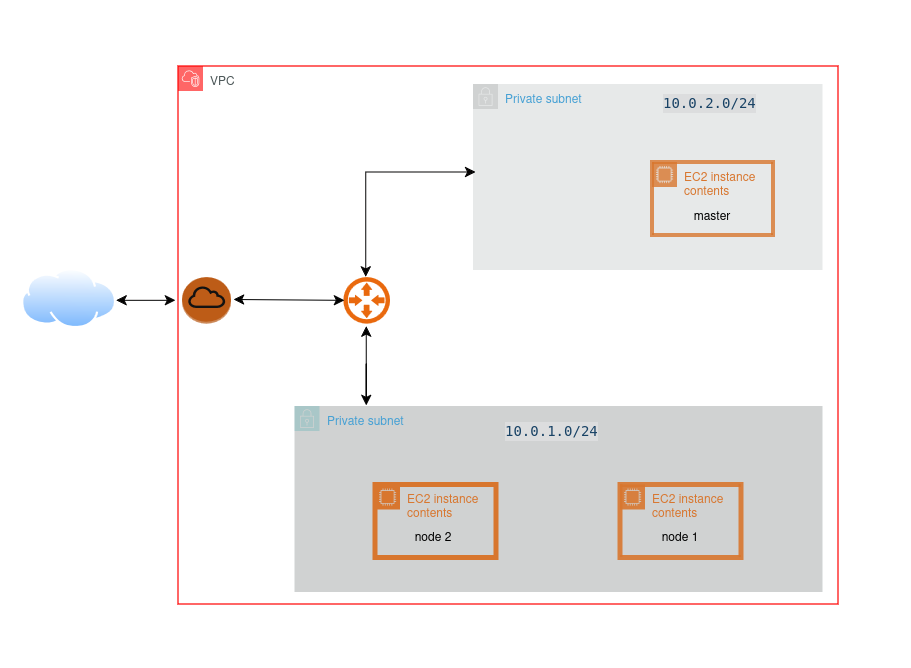
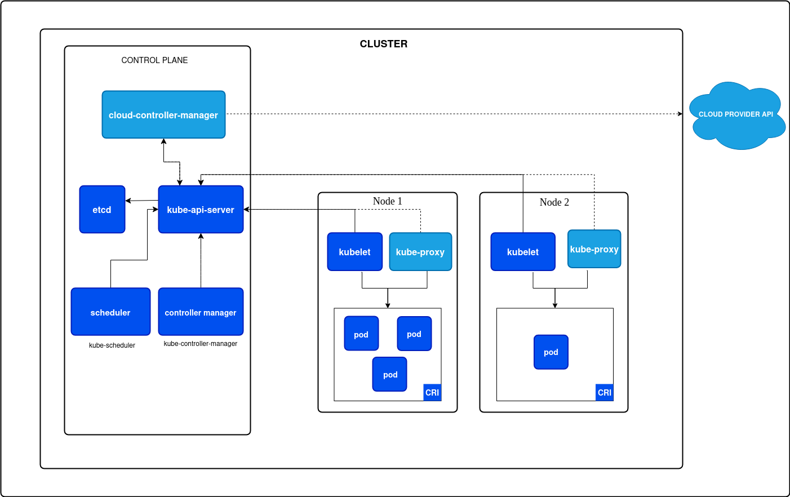

# AWS Kubernetes Cluster with Terraform and Ansible

This project provisions an AWS environment with Terraform and configures a small Kubernetes cluster with Ansible.

The cluster contains:

- 1 Kubernetes control-plane node: `master`
- 2 Kubernetes worker nodes: `worker1` and `worker2`
- 1 VPC with CIDR `10.0.0.0/16`
- 2 public subnets: `10.0.1.0/24` and `10.0.2.0/24`
- 3 EC2 instances with public IP addresses
- Docker, `kubeadm`, `kubelet`, and `kubectl` installed on every node

## Cluster infrastructure


## Cluster Architecture



## Architecture

```text
AWS Region: eu-north-1
└── VPC 10.0.0.0/16
    ├── Public subnet 10.0.1.0/24
    │   └── master
    └── Public subnet 10.0.2.0/24
        ├── worker1
        └── worker2
```

Terraform creates the VPC, internet gateway, public route table, public subnets, security group, SSH key pair, and EC2 instances. Ansible then prepares the operating systems, initializes the master, and joins the workers to the cluster.

## Repository structure

```text
.
├── README.md
├── ansible/
│   ├── ansible.cfg
│   ├── inventory/inventory.yaml
│   ├── playbooks/cluster-k8s.yaml
│   └── roles/
│       ├── common/    # Common packages and Kubernetes prerequisites
│       ├── master/    # kubeadm init and control-plane configuration
│       └── worker/    # kubeadm join
├── images/            # Architecture images
├── keys/              # Generated private SSH key
└── terraform/
    ├── main.tf
    ├── variables.tf
    └── outputs.tf
```

## Prerequisites

Install and configure:

- AWS CLI
- Terraform
- Ansible
- Graphviz, only if you want to generate Terraform diagrams

Configure AWS credentials:

```bash
aws configure
```

The Ansible role uses Debian/Ubuntu `apt` packages. Use an Ubuntu AMI compatible with the repository configuration, such as Ubuntu 24.04, in `terraform/variables.tf`.

The security group currently allows SSH and ICMP from `0.0.0.0/0`. Restrict these rules before using this project in production.

## 1. Provision AWS infrastructure

From the repository root:

```bash
cd terraform
terraform init
terraform validate
terraform plan
terraform apply
```

Display the public IP addresses:

```bash
terraform output
```

Copy the resulting public IPs into `ansible/inventory/inventory.yaml`:

```yaml
all:
  children:
    masters:
      hosts:
        master:
          ansible_host: "MASTER_PUBLIC_IP"
    nodes:
      hosts:
        worker1:
          ansible_host: "WORKER1_PUBLIC_IP"
        worker2:
          ansible_host: "WORKER2_PUBLIC_IP"
```

Keep the correct SSH user and private key path in the inventory. The generated key is stored at `keys/nb-key-pair.pem`.

## 2. Configure the Kubernetes cluster

Test SSH connectivity first:

```bash
cd ansible
ansible all -m ping
```

Run the complete playbook:

```bash
ansible-playbook -i inventory/inventory.yaml playbooks/cluster-k8s.yaml
```

The playbook runs these stages:

1. `common`: updates hosts, disables swap, installs Docker and Kubernetes packages, and starts required services.
2. `master`: runs `kubeadm init`, configures the master kubeconfig, installs Flannel, and creates the worker join command.
3. `worker`: reads the join command from the master and runs `kubeadm join` on `worker1` and `worker2`.

## 3. Verify the cluster

On the master node:

```bash
kubectl get nodes
kubectl get pods --all-namespaces
```

The master and both workers should eventually appear as `Ready`.

## Useful commands

Check the inventory without changing hosts:

```bash
cd ansible
ansible-inventory -i inventory/inventory.yaml --graph
```

Validate the playbook syntax:

```bash
ansible-playbook -i inventory/inventory.yaml playbooks/cluster-k8s.yaml --syntax-check
```

Regenerate Terraform dependency diagrams from `terraform/`:

```bash
terraform graph -type=plan | dot -Tpng > ../images/graph.png
terraform graph | dot -Tpng > ../images/arch.png
```

Destroy the AWS infrastructure when finished:

```bash
cd terraform
terraform destroy
```

## Security notes

- Never commit private keys or cloud credentials.
- Restrict SSH access to your own public IP instead of `0.0.0.0/0`.
- Restrict Kubernetes and cluster traffic according to your network design.
- Review the Terraform state file before sharing the repository; it can contain infrastructure details.